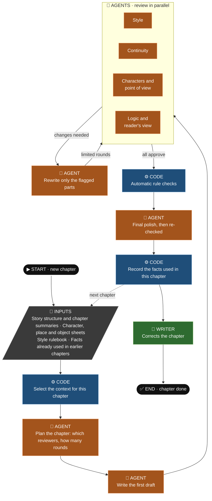

<h1 align="center">TH Drafting: process design</h1>

  
  
  
  
  
  

This repo contains only the process design. The code, prompts and style rules are private.

## Status

Used in production on a full novel. The publishing project has since closed,
so the tool is no longer developed.

## Contents

- [The problem](#the-problem)
- [What I did](#what-i-did)
- [How the pipeline works](#how-the-pipeline-works)
- [Results](#results)
- [Tests and evals](#tests-and-evals)
- [Why there's no code](#why-theres-no-code)

## The problem

A novelist and I tried to start a publishing house. His job was to design the story
structure and the prose style for our target readers.

Once that was done, a single book of about 50 chapters (a length chosen for our target)
took **3–4 months** from zero to a corrected first draft.

I mapped the process, and one step took most of the time: turning the structured scene
outlines into a first draft. It was also the least valuable step: going from first draft
to corrected draft was much faster and fixed most of the problems, and beta readers then
polished the corrections.

We tried the existing tools first:

| | GPT-4o via API, Novelcrafter | What we needed |
|---|---|---|
| **Context** | loses track across 50 chapters | every chapter knows the characters, places and facts already used |
| **Style** | follows the rules loosely | follows a strict, house-specific rulebook |
| **Control** | one prompt, one answer | each rule checked, and the draft sent back when it fails |

## What I did

- **Automated the first draft.** The writer starts from a generated draft and spends
  his time correcting it, instead of writing everything from a blank page.
- **Turned the novelist's method into precise rules.** Together with him, I wrote his
  style and structure down as explicit rules, so that a model can follow them and a
  check can verify them. The rulebook kept growing as we found new problems. About 30%
  of the rules are checked by plain code (word counts, banned patterns); the rest are
  checked by a model.
- **Kept the model out of the control flow.** The order of the steps, the approval logic
  and the retry limits are fixed in code. The model only writes and reviews, plus one
  choice per chapter: which reviewers to run and how many rewrite rounds to allow.

## How the pipeline works

How the loop stays reliable:

- Each reviewer checks one thing and never reads the other reviewers' reports, so one
  opinion doesn't sway the others. A chapter passes only if every reviewer approves and
  the automatic checks pass too.
- A missing or malformed review counts as "needs changes". A review that quotes text
  that isn't in the draft is thrown out. When the rewrite rounds run out, the chapter
  goes to the writer with a flag.
- After each chapter, the facts it used (places, objects, details) are recorded, so the
  next chapters don't repeat or contradict them.

How it stays cheap:

| | |
|---|---|
| **Models** | Haiku for narrow checks, Sonnet for writing and rewriting |
| **Caching** | the fixed part of each prompt is cached: from the second round on, most input tokens cost ~10% |
| **Parallel reviews** | reviewers run at the same time, since they don't depend on each other |
| **Tracking** | tokens and cost logged for every chapter |
| **Executors** | same pipeline through the API, through an agent harness with no API key, or by hand to debug a step |

## Results

| | Before | After |
|---|---|---|
| Time per book (~50 chapters) | 3–4 months | **~2 weeks**: 1 week of structuring, 1 week of corrections |
| Writer's correction time, whole book | – | **~20 hours** |
| What the writer spends time on | writing drafts | structuring and correcting |

Measured on one novel. The drafts still need the writer, but fewer corrections as models improve,
because how well the rules are followed depends on the model.

## Tests and evals

| | |
|---|---|
| **Tests** | 175 automated tests on the pipeline |
| **Evals** | 15 cases built on real material, covering 11 reviewer roles. Each case lists what a good reviewer must find; every prompt change is scored against them |
| **Decisions** | 12 written architecture decisions, including rejected options. Example: merging all reviewers into one call was cheaper, but the reviewers influenced each other, so I dropped it |

## Why there's no code

The prompts, the rulebook and the orchestration are the core of the work and belong to
the publishing project, so they stay private.